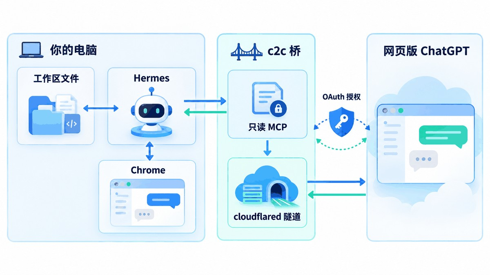
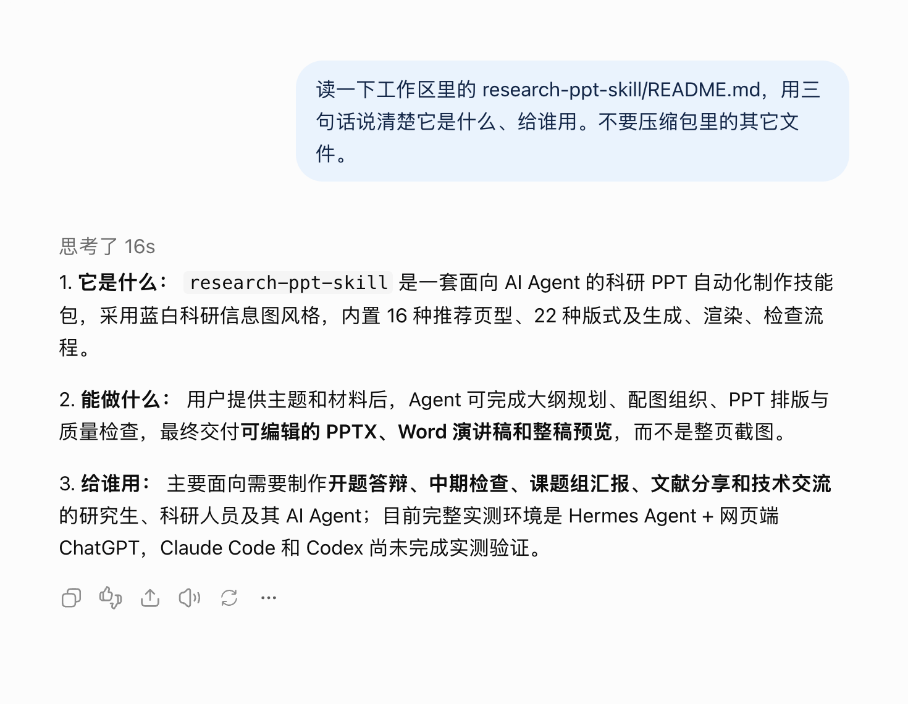
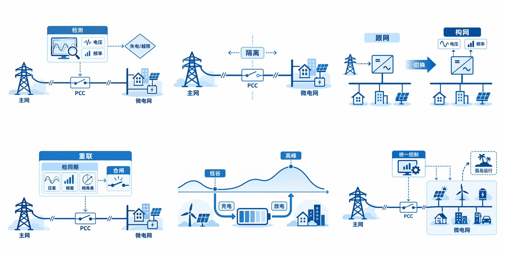

# hermes-chatgpt-web

> 让 Hermes 把网页版 ChatGPT 当大脑用：它出方案、挑毛病、画图；Hermes 动手执行、取回产物、逐条核验。
> 你已经在付那份订阅的钱，别让它只用来聊天。

[](#一句话部署)
[](LICENSE)
[](#一句话部署)

---

## 先说它解决什么

我干活的方式一直是：agent 动手，但方案不该由 agent 拍脑袋定。

有次让 agent 做技术分享的 PPT，它自己估字号、自己翻模板、自己从头手搓版式，交了五轮全被否。换成另一条路立刻就好了：把材料扔给网页端 ChatGPT，只要它给一份说得清的方案，agent 照着做。它一次就把「先核对数据，再按背景、框架、结果、局限组织」排好了，还自己发现「五页拼版不符合一页一张完整图」。

麻烦在交接。以前只能把文件内容、日志、diff 复制粘贴进聊天框，慢，容易失真，还把上下文撑爆。

这个仓库就是那一步的成品：用一条只读的 MCP 连接（`c2c` 桥）把你当前的工作目录露给网页端 ChatGPT，它要哪个文件自己读。没有人粘贴任何代码、diff 或日志。



---

## 装完你会多四句口令

| 你说 | 它干什么 |
|---|---|
| 让 GPT 看一下这个方案 | 把背景交给它，它读工作区文件，回一份可实现的方案 |
| 让 GPT 审一下 | 把执行结果和 diff 交给它，它挑毛病，agent 改完再送审 |
| 让 GPT 画张图 | 它出图，agent 从页面里取回原文件字节，验真后落盘 |
| 让 GPT 帮我把这篇写完 | 它写，agent 落成文件，再送回同一对话复审 |

最直接的证据：下面这张是真截图。我在新对话里让它读工作区里的一个 README，它自己调连接器读了文件，16 秒后按三句话回答。我没有粘贴任何内容。



出图也是同一条链路。下面这几张是它一次任务里画出来的插画（一份 PPT 的配图），agent 取回原图、核对标签、按尺寸贴进版面：



---

## 四种场合，我是这么用的

**动手前先要方案。** 装修、选题、重构、写文档，先让它读现状，再让它给两三个走法，agent 照着第一个走。省下的不是打字时间，是走错路的时间。

**提交前让它挑毛病。** agent 改完代码或文档，让它自己读 diff 和测试输出，以审查者身份给意见。它指出过真缺陷，也提过我不认同的，这正常，我自己判断。

**配图外包给它。** PPT 里的概念插画、公众号头图、示意图，一次要八九张，挑最好的用。比在本机跑生图模型稳，也不会把 16 GB 的机器卡死。

**长文一起磨。** 先让它写，agent 落成 md，再送回同一个对话让它审。第二轮它才会去翻术语表、附录、脚注这些角落；只跑一轮的话，附录里的旧表述会留在成品里。

---

## 一句话部署

**macOS / Linux**

```bash
curl -fsSL https://raw.githubusercontent.com/d2dmh/hermes-chatgpt-web/main/install.sh | bash
```

**Windows**（PowerShell）

```powershell
irm https://raw.githubusercontent.com/d2dmh/hermes-chatgpt-web/main/install.ps1 | iex
```

不想碰终端也行，把下面这段原样发给 Hermes：

```text
帮我装 https://github.com/d2dmh/hermes-chatgpt-web ：读它的 README，按里面的说明把 skill 装进你自己，
再按 skill 里的 references/bridge-setup.md 把桥（c2c）装好并完成首次接入，全程你自己做，
只有需要我登录 ChatGPT / Cloudflare 时才叫我，一次只给我一个动作。
```

装的过程会 clone 两个仓库、装 cloudflared、构建一次，三到五分钟。不改动你已有的 skill，同名会先备份。

---

## 前置条件只有两条

**一、你已经有 Hermes。** 这套东西是给 Hermes 用的 skill，不是独立软件。

**二、这个 Hermes 能控制浏览器。** 整套协作靠这双手：开新对话、往输入框打字、把回复读回来，全靠通过 CDP 驱动一个普通 Chrome。配法见 [`cross-platform.md`](skills/chatgpt-web-planning/references/cross-platform.md)。

第二条暂时配不上也能先跑通一半。首次接入的最后一步（在 ChatGPT 里建连接器、填配对码）本来就是人手点的，不需要调试端口，用你平时的浏览器点几下就行，步骤见 `bridge-setup.md` 里的「没有浏览器控制权限时：手动路径」。先把链路验通，再决定要不要把自动化配上。

**只要浏览器，不要 API key。** 走的是你已经付费的网页版 ChatGPT，没有 API 计费，也没有逆向代理。

适配情况老实说：

| 平台 | 状态 |
|---|---|
| macOS | 全程跑过：答辩稿、组会稿、PPT 配图、文档复审都做过 |
| Linux | 安装脚本覆盖，没在真机长期跑 |
| Windows | 真机验证到「skill 装好、c2c 构建成功、隧道通」；任务计划程序自启、剪贴板挂附件这几项还没在真机验证，用到时把结果回填进 `cross-platform.md` |
| Claude Code / Codex | skill 能读，但桥和浏览器操作没在它们上面测过，理论上要自己接一遍 |

---

## 它是怎么工作的

| 名词 | 是什么 | 在这里干什么 |
|---|---|---|
| Hermes | 你本机的 agent | 执行：改文件、跑测试、点页面、取回产物 |
| skill | 一份 Markdown 手册（`SKILL.md` 加参考文件和脚本） | 把流程、判据、坑固化下来 |
| MCP | 模型调用工具的标准接口 | 让网页端 ChatGPT 能调用本机的读取工具 |
| c2c 桥 | 第三方开源小工具（[codex-with-chatgpt](https://github.com/XiaoDuoYa/codex-with-chatgpt)，MIT） | 在本机起一个只读 MCP 服务，并把端口暴露出去 |
| cloudflared | 把本机端口映射成公网网址 | ChatGPT 才能访问到你本机的桥 |
| OAuth / 配对码 | 一次性授权 | 你填了码，它才可以读你的工作区 |
| CDP | Chrome 调试协议 | agent 用它真的去点页面 |

一次真实调用长这样：

```
你说：「让 GPT 看一下这版方案，然后按它的意见改」
  │
  ├─ 1. agent 跑 c2c doctor          桥、隧道、连接器都正常？不绿就先修，不发消息
  ├─ 2. 在协作浏览器里开一个全新对话   一个任务一个对话
  ├─ 3. 发一条约 1 KB 的任务说明       目标、范围、限制、成功标准；不粘任何文件内容
  │      └─ ChatGPT 用自己的连接器读工作区：workspace_info → read_file → git_diff
  ├─ 4. 它回一份可实现的方案
  ├─ 5. agent 执行：改文件、跑测试，用 c2c record 把摘要写回工作区
  ├─ 6. agent 发 EXECUTED             请它自己读 diff 和测试输出，给独立审查意见
  ├─ 7. 它回审查意见                  agent 按意见改，回到第 5 步
  └─ 8. 通过后 agent 才向你汇报，并核验产物（图片走 sha256 和 C2PA 验真）
```

分工是这套东西的地基：网页端出主意和挑毛病，本机 agent 动手且负责核验。所以 skill 里写死了两条规矩。一条是只传背景和需求，别替它定版式、字号、字数这些规格，那是它的专业范围。另一条是发任务时就要求它切到独立审查者身份自审，实测它会自己驳回三批引入了虚构组件的架构图。

---

## 仓库里有什么

```
hermes-chatgpt-web/
├── install.sh / install.ps1          一句话部署的两半（macOS/Linux · Windows）
├── skills/chatgpt-web-planning/      技能本体，装进 Hermes 的 skills 目录
│   ├── SKILL.md                      流程、判据、口令触发、坑表
│   ├── references/
│   │   ├── bridge-setup.md           首次接入：装桥、建连接器、配对、验证
│   │   ├── cross-platform.md         macOS 与 Windows 差异对照、开机自启
│   │   ├── browser-pitfalls.md       输入法、坐标、多标签、发送判据
│   │   ├── media-export.md           取回图、视频、PDF 并验真（C2PA）
│   │   ├── slide-image-pipeline.md   整页生图流水线
│   │   └── uploading-files-to-web-chatgpt.md   把文件挂进输入框
│   ├── scripts/
│   │   ├── verify_asset_origin.py    验真：字节数、sha256、容器结构、出处签名
│   │   └── gen_helper.py             生图辅助：判完成、取字节、去重、命名
│   └── templates/agent-runbook.md    给别人的 agent 看的复现说明骨架
└── docs/                             架构图、实拍截图、原理与实测记录
```

---

## 路上的坑，挑几个说

完整的坑表在 skill 里，这里只放最让人意外的几个。

| 现象 | 为什么 | 怎么办 |
|---|---|---|
| 网页端调用报 401，本地自检却说一切正常 | 自检比的是自己记的地址，会漂移；ChatGPT 上的连接器还指着已死的旧地址 | 用一次真实的 `workspace_info` 验证；不行就删掉连接器重建，「重新连接」对死地址无效 |
| 授权页说 `authorization request has expired`，重试也没用 | OAuth 请求只能提交一次，用脚本直接写输入框会把请求消耗掉却不带码 | 真实点击、逐字符输入配对码、真实点 Connect；过期就重新生成 |
| 重启机器后每次都要重新配对 | 默认隧道地址每次重启都变 | 配固定域名（named tunnel），或者接受「重启就重建连接器」 |
| 自动化启动的浏览器登录 Google 被拒 | 自动化实例带 `navigator.webdriver = true` 指纹 | 用原生启动的 Chrome，独立 profile 加调试端口承载登录态 |
| 字打进去了，发送按钮不出现 | 页面里历史消息的提示词块也是可编辑区域，字打进了旧块 | 输入框用 `form div[contenteditable="true"]` 精确定位，逐字符真键 |
| 点了下载，下载目录里没有新文件 | 那个控件走系统保存对话框，自动化环境不落盘 | 从页面里直接取原文件字节，和页面上的图逐字节相同；落盘后跑验真脚本 |
| 它给的图看着像模型产出，其实是截图 | 截图也是 PNG，肉眼看不出 | 验真看三样：字节与页面一致、PNG 容器结构、C2PA 出处签名 |
| 一个对话聊久了它开始变糊 | 上下文太长 | 一个任务一个对话；同一任务的复审留在同一对话 |
| 挂着代理，本地端点请求卡死 | 系统代理把 `127.0.0.1` 也劫走了 | 设 `NO_PROXY=127.0.0.1,localhost,::1`；`curl`、`git`、`pip` 只认 `https_proxy` 环境变量 |

---

## 常见问题

**要花 API 的钱吗？** 不要。走的是你已付费的网页版 ChatGPT，没有 key，也没有逆向代理。

**我的代码会被上传吗？** 不会。连接器只读，ChatGPT 按需读它要的那几个文件。skill 里禁止把文件内容粘进聊天，也禁止把仓库加进 Project 的 sources。

**团队里有人只有 Windows？** 支持，但要看清上面那张适配表：安装、构建、隧道都验证过，任务计划程序自启和剪贴板挂附件还没在真机跑过。第一次装完把实际结果回填进 `cross-platform.md`，那份文档才算完整。

**安装时被安全扫描拦了（报 DANGEROUS）？** 内容型误报，安装脚本已经带 `--force`。这套文档逐字记录了 launchd 自启、`pnpm install`、base64 分块读字节这些命令，扫描器按关键词判成持久化和混淆。仓库里除了 `verify_asset_origin.py`（读一个 PNG 的字节，打印哈希和 C2PA 标识）和 `gen_helper.py`（浏览器辅助函数）没有可执行代码，可以逐行核对。

**Hermes 不被允许控制浏览器怎么办？** 先说清楚：这套协作的「手」就是浏览器控制，缺了它日常协作只能人当打字员。但首次接入的最后一步本来就是人手点的，用你平时的浏览器就能做完，步骤在 `bridge-setup.md` 的手动路径那一节。

**换机器、换工作区会怎样？** 换工作区等于新连接器，一个工作区一个。换机器要重做一次首次接入。绑定关系写在 `~/.hermes/handoffs/chatgpt-web-state.md`（Windows 在 `%USERPROFILE%\.hermes\handoffs\`），下一个 agent 读它就能接着干。

**怎么更新？** 重跑安装脚本，它会 `git pull` 并重装 skill。Hermes 侧也可以走官方路径：`hermes skills check` 报告有更新，再 `hermes skills update`。

**装的时候提示 GitHub API 限流？** 未认证调用每小时只有 60 次。装好 `gh` 并 `gh auth login`，或者把 `GITHUB_TOKEN` 写进 `~/.hermes/env`，就能放宽到 5000 次。限流时安装脚本会退回本地拷贝，内容一致，功能不受影响，只是不能用 `hermes skills update` 自动更新。

---

## 配合着用

这套东西最容易看出价值的地方，是把它接到一个具体的产出上。仓库 [research-ppt-skill](https://github.com/d2dmh/research-ppt-skill) 就是拿来配它的：大纲交给网页端 GPT，插画也让网页端画，Hermes 负责生成、检查、逐页看图。那边 README 里那份 21 页的微电网分享稿，就是这么出来的。

---

## 致谢与许可

桥（`c2c` / codex-with-chatgpt）是 [@XiaoDuoYa](https://github.com/XiaoDuoYa) 的开源项目，MIT。本仓库只调用它，不包含它的源码，安装脚本会 clone 到你本机。上游的 skill 是给别的宿主写的；这里这份是同一套能力在 Hermes 上的实现，只保证 Hermes 加一个能被 CDP 驱动的 Chrome 这条路。

本仓库内容以 MIT 发布，见 [LICENSE](LICENSE)。

文中的数字（速度、字节、几轮通过）都来自一台 Apple M5、16 GB、macOS 的笔记本，中国网络环境，家用宽带加本地代理。你的机器上不会完全一样，判据是一样的。

---

## 如果这套东西帮你省了来回粘贴的时间

点个 star，别人搜「ChatGPT 读本地文件」「agent 协作」时才可能翻到这儿。

用出问题了就开 issue，把 `c2c doctor` 的输出贴上来，那比描述现象有用得多。
